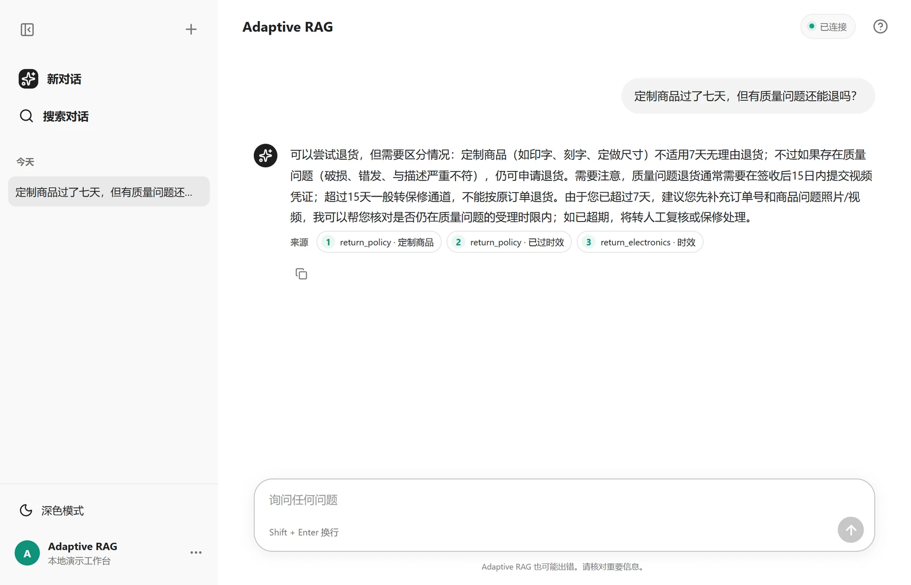
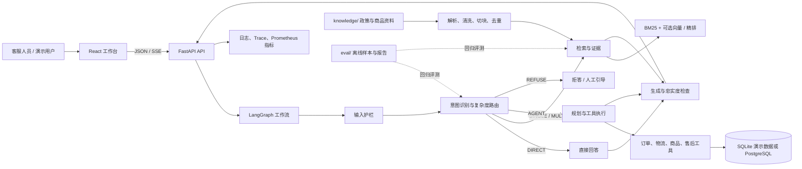

<h1 align="center">CaseDesk｜电商智能客服与售后工作台</h1>

<p align="center"><strong>将政策咨询、商品导购、订单/物流查询与售后申请收敛到一个可本地运行的客服工作台。</strong></p>

<p align="center">FastAPI × LangGraph × React · 自适应路由 · 可溯源检索 · 人工确认写操作</p>

> [!IMPORTANT]
> CaseDesk 是基于本地样例知识库与订单数据运行的个人项目/演示环境，不是已接入真实交易、承运商或身份系统的生产客服。本文把已实现、已测量和待建设分开说明；不要把演示数据、离线评测或代码配置表述为线上业务指标。

---

## 项目快照



<p align="center"><sub>现有 Web 工作台：流式对话、来源引用、会话搜索、主题切换与高风险操作确认卡片。</sub></p>

## 解决什么问题

电商客服的输入并不都是“查一个 FAQ”：问候无需检索；退换货规则需要引用依据；多个限制条件可能需要多次检索；订单、物流和售后申请又涉及用户数据与写操作。CaseDesk 将这些请求放进同一个工作流：

- 政策与商品问题走知识检索，回答可带 `citations`；
- 订单、物流、商品、优惠与售后请求由规划器选择受限工具；
- 退款、退货和取消订单先生成待确认操作，确认后才执行；
- 每个请求生成 `trace_id`，并在响应中返回策略、耗时和 token 统计字段；
- 模型、缓存、向量库或精排不可用时会选择本地/离线降级路径，可由 `/api/v1/capabilities` 查询实际后端。

当前仓库没有真实人工接管率、GMV、成本节省或生产 SLA 的证据，因此不宣称这类结果。

## 与单一 RAG Demo 的差别

| 维度 | 已在仓库中实现的做法 | 对应位置 |
| --- | --- | --- |
| 路由 | `DIRECT`、`SINGLE`、`MULTI`、`AGENT`、`REFUSE` 五类策略 | `app/retrieval/adaptive.py`、`app/agents/graph.py` |
| 知识检索 | BM25 与可选稠密向量检索经 RRF 融合；可选 Cross-Encoder 精排；内存/Redis 缓存 | `app/retrieval/` |
| 多条件问题 | 查询改写与 Self-RAG 检索循环；默认最多 3 跳 | `app/retrieval/self_rag.py`、`app/config/settings.py` |
| 业务工具 | 15 个注册工具覆盖订单、物流、商品、优惠、库存、售后、知识检索与转人工 | `app/tools/factory.py` |
| 写操作安全 | 参数校验、订单可见性检查、风险分级、显式确认、幂等记录 | `app/tools/`、`app/repositories/idempotency.py` |
| 回答可靠性 | 输入注入拦截；在线模型路径做忠实度检查、一次自纠错，证据不足时拒答/转人工 | `app/guardrails/`、`app/agents/nodes/faithfulness.py` |
| 工程接口 | JSON 与 SSE、健康/就绪/能力探针、结构化日志、Prometheus 指标 | `app/api/`、`app/observability/`、`app/main.py` |
| 可验证性 | Python 测试目录、前端 Vitest 用例、离线数据集与评测运行器 | `tests/`、`frontend/src/**/*.test.*`、`eval/` |

“可选”表示组件是否启用取决于环境和配置；不能把代码中的可选组件写成当前环境已加载的服务。

## 一眼看懂架构



### 数据与质量闭环：已实现的最小形态

| 环节 | 当前实现 | 尚未实现，不能夸大 |
| --- | --- | --- |
| 数据供给 | `knowledge/` 文档在启动时解析、清洗、切块、精确去重并构建 BM25/向量索引；非 Markdown 输入有 PII 掩码逻辑 | 客服全量会话、商品图/直播视频统一采集，标注平台、特征库、自动微调数据生产 |
| 业务执行 | LangGraph 连接检索、规划、工具、回答、忠实度与会话压缩节点；SQLite 可显式灌入演示订单 | 真实 OMS/CRM/物流/支付系统、可靠多租户与线上人工工单闭环 |
| 质量控制 | `eval/` 含意图、检索、E2E 样本及运行器；测试目录覆盖关键组件；`/metrics` 暴露运行时指标 | 7 维自动评测中台、线上 A/B、告警闭环、人工标注回流或自动再训练 |

这是一条“知识资料 → 检索/Agent → 离线评测与代码回归”的最小闭环，不是已经建成的数据中台和评测中台；后者见[路线图](#路线图明确是规划)。

## 已实现功能与使用边界

### 五条处理路径

| 策略 | 适合的输入 | 系统处理 |
| :---: | --- | --- |
| `DIRECT` | 问候、闲聊 | 直接生成，不检索知识库 |
| `SINGLE` | 单一政策或 FAQ | 一轮检索与可选精排 |
| `MULTI` | 多条件、跨条款问题 | 改写、补检与自纠错 |
| `AGENT` | 查订单、物流、商品或发起售后 | 规划后调用受限制的业务工具 |
| `REFUSE` | 越权、明显提示注入或证据不足 | 拒答，或提示补充信息/转人工 |

### 订单与售后安全

`create_refund_request`、`create_return_request`、`cancel_order` 都是写操作。首次请求只会返回 `pending_action`；客户端需要在同一 `session_id`、同一 `user_id` 下带回 `confirm_action_id` 才能继续执行。待确认操作仅保存在服务进程内 15 分钟，服务重启或多实例切换后需要重新发起。

订单可见性会按请求中的 `user_id` 过滤，但当前 API **不认证**这个字段。前端默认的 `u_demo` 仅为本地演示；面对不可信用户部署前，必须由服务端可信认证层绑定用户和会话，不能直接相信请求体。

### 还没有的能力

- 订单、物流、退款与退货均使用本地种子/仓储数据，未连接真实交易、承运商、支付或 CRM；
- 没有媒体运营、直播切片、素材管理、销售培训等独立业务 Agent；商品推荐是工具能力，并非已验证的个性化推荐系统；
- 没有聊天/商品/视频统一数据平台、标注平台、模型微调流水线或线上自动回流；
- 没有服务端用户认证、多租户隔离、增量知识库删除 API 或默认 Alembic 迁移流程；
- PII 掩码、提示注入检测与忠实度判定都是现有防线，不等于完整的生产级安全合规保证。

更完整的限制说明见 [`docs/12-limitations.md`](docs/12-limitations.md)。

## 快速开始（Windows PowerShell）

需要 Python 3.11+；Web 开发还需要 Node.js `^20.19.0` 或 `>=22.12.0` 与 npm。命令均在项目根目录执行。

```powershell
py -3.11 -m venv .venv
.\.venv\Scripts\Activate.ps1
python -m pip install --upgrade pip
python -m pip install -e ".[dev]"

# 仅在不存在时创建本地配置；不要提交 .env 或任何密钥。
if (-not (Test-Path .env)) { Copy-Item .env.example .env }

Push-Location frontend
npm ci
Pop-Location
```

未配置 `DEEPSEEK_API_KEY` 时，系统使用离线实现来演示可核验的检索/订单结果；要使用生成式模型，需要由你在本地 `.env` 配置自己的密钥。README 不读取、不输出也不保存该文件中的值。

### 启动 API 和工作台

```powershell
.\scripts\dev-start.ps1
```

该脚本以轻量本地配置在后台启动 FastAPI 和 Vite；默认地址为：

- 工作台：<http://127.0.0.1:5173>
- 健康检查：<http://127.0.0.1:8002/api/v1/health>
- OpenAPI 文档：<http://127.0.0.1:8002/docs>

端口冲突时可显式指定：

```powershell
.\scripts\dev-start.ps1 -ApiPort 8010 -FrontendPort 5174
```

### 发送第一条政策问题

```powershell
$body = @{ message = '定制商品超过七天但有质量问题还能退吗？'; user_id = 'u_demo' } |
  ConvertTo-Json

Invoke-RestMethod `
  -Method Post `
  -Uri 'http://127.0.0.1:8002/api/v1/chat' `
  -ContentType 'application/json' `
  -Body $body
```

响应包含 `answer`、`session_id`、`trace_id`、`intent`、`strategy`、`citations`、`pending_action`、`token_usage` 与 `latency`。流式接口为 `POST /api/v1/chat/stream`；健康、就绪与实际后端能力分别见 `GET /api/v1/health`、`/api/v1/ready`、`/api/v1/capabilities`。

### 演示订单与人工确认

默认启动不会自动写入订单。先停止 API，再执行：

```powershell
.\.venv\Scripts\python.exe .\scripts\seed_demo.py
```

这会为本地演示用户 `u_demo` 创建 `ORD10001` 到 `ORD10003`。重启 API 后可先问“帮我查 ORD10001 的物流”；对“取消 ORD10003”会先得到确认卡片。该操作只影响本地演示数据库。

## API、运行与部署

| 接口 | 用途 |
| --- | --- |
| `POST /api/v1/chat` | 返回单次完整 JSON 响应 |
| `POST /api/v1/chat/stream` | 返回 SSE 的节点、token、answer 与 done 事件 |
| `GET /api/v1/health` / `ready` | 存活与数据库/可选依赖状态 |
| `GET /api/v1/capabilities` | 显示实际使用的数据库、缓存、检索、精排与 LLM 后端及降级状态 |
| `GET /metrics` | Prometheus 格式指标 |
| `GET /docs` | FastAPI 自动生成的接口文档 |

Docker 编排分为三种配置；默认演示模式不要求外部模型密钥、PostgreSQL、Redis 或 Qdrant：

```powershell
# SQLite + 内存/离线降级的默认演示
docker compose up --build -d

# 单 API + PostgreSQL + Redis
$env:POSTGRES_PASSWORD = 'choose-a-local-password'
docker compose -f docker-compose.single.yml up --build -d

# 两个 API 实例 + PostgreSQL + Redis + Qdrant + Nginx
docker compose -f docker-compose.multi.yml up --build -d
```

Docker 默认暴露 <http://127.0.0.1:8000>。单机与多实例模式会尝试加载本地 embedding/精排模型；首次拉取模型的网络、磁盘与内存开销需自行评估。部署说明见 [`docs/11-deployment.md`](docs/11-deployment.md)。

## 测试、构建与评测

### 可复现命令

```powershell
# Python：单元、集成与 API 端到端测试
.\.venv\Scripts\python.exe -m pytest -q

# 前端：Vitest 与 TypeScript/Vite 构建
Push-Location frontend
npm test
npm run build
Pop-Location

# 需要模型密钥的意图离线评测
.\.venv\Scripts\python.exe -m eval.runner --task intent --llm
```

`.github/workflows/ci.yml` 定义了 Python 3.11/3.12 的锁文件检查、Ruff、mypy、pytest 与 70% 覆盖率门槛。该目录当前没有 `.git`，因此无法从本地确定 CI 是否实际运行过、提交版本或改动归属。

### 当前可核验的评测口径

仓库内 [`eval/reports/latest.json`](eval/reports/latest.json) 是 2026-11-10 的 100 条中文意图样本报告：

| 口径 | 准确率 | 应如何表述 |
| --- | ---: | --- |
| `intent_rules` | 50.0% (50/100) | 关键词规则基线 |
| `intent_v1`，无覆盖层 | 88.0% (88/100) | 一次模型版本 |
| `intent_v2`，无覆盖层 | **91.0% (91/100)** | 当前报告中的纯模型分类结果 |
| `intent_v3` + `intent_overlay` | 100.0% (100/100) | 含为该样本集编写的覆盖层，不能表述为纯模型准确率或泛化能力 |

`eval/MEASURED.md` 还记录过一轮更早的检索/生成/E2E 测量，但对应的完整原始报告不在当前目录，且与 `latest.json` 的日期、数据集和口径不同。因此本 README 不把其中的检索、幻觉率、延迟或“154 passed”写成当前可复现结论。请在固定代码、模型版本、数据集和随机性设置后重新运行并归档报告。

### 本次工作区验证状态（2026-11-10）

- 已核对：项目目录、依赖声明、接口、核心工作流、工具、安全逻辑、测试/评测文件及 Docker 编排；
- 后端：受控环境中运行 `python -m pytest -q`，结果为 **163 passed, 1 warning in 2.38s**；唯一警告来自 LangGraph 依赖的 `allowed_objects` 默认值将变更，不是测试失败。受限沙箱会拦截 pytest 临时目录/缓存写入，故本次通过结果使用允许写入临时目录的受控测试执行获得；
- 前端：当前机器找不到 `npm` 可执行文件，`npm test` 与 `npm run build` 未运行；
- 未读取 `.env` 内容、未使用密钥、未提交或推送任何变更。

## 项目结构

```text
app/          FastAPI、LangGraph、检索、工具、存储与可观测性
frontend/     React + TypeScript 客服协作台
knowledge/    本地政策/商品知识资料
data/         本地 SQLite 运行数据（不应提交敏感数据）
eval/         离线数据集、指标、运行器和本地报告
tests/        单元、集成与 API E2E 测试
scripts/      开发启动和演示数据脚本
docs/         架构、API、评测、部署与限制说明
```

## 路线图（明确是规划）

以“有业务、有体系、可落地、有闭环”为目标，下一阶段应优先补足能被实际验证的链路，而不是堆叠名词：

1. 接入可信身份认证、服务端会话绑定、真实 OMS/物流/售后接口与审计；
2. 为知识库补充版本、增量删除、数据质量检查和人工标注流程；
3. 把评测扩展为答案正确性、工具调用、召回、权限/安全、时延/成本、异常处理和业务合规七个维度，并保存每轮原始报告；
4. 用真实而脱敏的业务样本，验证人工接管率、首响、解决时长、工具成功率和单位请求成本；
5. 在上述基础可复现后，再评估素材、直播、培训等新的业务 Agent 是否值得接入共享的数据与评测能力。

## 贡献与证据边界

当前目录没有 Git 元数据，无法依据本地历史确认作者、提交范围或“从零开发”的个人贡献；也不能由文件名推断具体实习职责。仓库中仍可见 `adaptive_rag_cs` 包/容器命名等上游痕迹，而 `pyproject.toml` 与应用标题使用 `casedesk`。

用于简历或面试时，请只陈述自己能用提交记录、PR、演示录屏、接口响应、评测原始报告或设计文档证明的改动。例如，可如实说“基于开源项目完成/改造了某个明确模块，并能演示其代码路径与验证结果”；不要声称独立搭建完整中台、生产上线或取得线上业务指标。建议补充以下证据后再压缩为简历项目：

- 可追溯的 Git 仓库、分支/提交、上游 fork 或变更清单；
- 可重复的启动录屏，以及政策问答、订单查询和确认写操作的 API/页面演示；
- 固定版本的评测输入、命令、原始输出、失败样本和复测日期；
- 你负责的设计决策、故障排查、测试修复与代码审查记录。

## 上游与许可证

CaseDesk 的目录结构与能力基础参考 [JEen-wang/Adaptive-rag](https://github.com/JEen-wang/Adaptive-rag)。上游 README 的信息组织方式（问题、架构、快速开始、评测、限制与溯源）被沿用；本 README 的功能陈述以当前本地文件为准，不把上游的简历文字或指标自动迁移为 CaseDesk 事实。

项目保留 [MIT License](LICENSE) 及相应版权/授权声明。使用、修改或分发时，请同时保留上游许可与出处。
