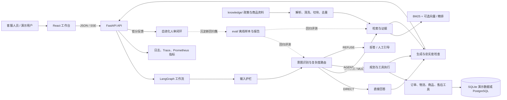

# CaseDesk

一个企业级智能客服和导购平台的原型，后端 FastAPI + LangGraph，前端 React。覆盖政策咨询、商品导购、订单物流和售后申请这几块。

技术栈：FastAPI · LangGraph · React · BM25 + 向量混合检索 · 写操作人工确认

---

## 长什么样


工作台支持流式对话、来源引用、会话搜索、深色模式，高风险操作会弹确认卡片。

## 为什么做这个

电商客服收到的输入不都是"查一个 FAQ"。问候不用检索，退换货规则得引用依据，多个限制条件可能要查好几次，订单物流和售后又涉及用户数据和写操作。用一条固定的 RAG 链路处理所有请求，会有几个问题：

- 简单问题也走完整检索和精排，白白拖慢；
- 只靠向量，订单号这种精确词召回变差；只靠关键词，口语化的问题又命中不了；
- 让模型直接执行退款、取消这类操作，一旦被提示注入或者理解错，没人把关就改了业务数据。

所以我的思路是**先判断、再分流**，让不同代价的请求走不同的路径。

## 和普通 RAG 有什么不一样

| 方面 | 怎么做 | 代码 |
| --- | --- | --- |
| 路由 | Direct / Single / Multi / Agent / Refuse 五条路径 | `app/retrieval/adaptive.py`、`app/agents/graph.py` |
| 检索 | BM25 和向量两路，RRF 融合，可选 Cross-Encoder 精排，带缓存 | `app/retrieval/` |
| 多条件问题 | 查询改写 + Self-RAG 检索循环，默认最多 3 跳 | `app/retrieval/self_rag.py` |
| 业务工具 | 15 个工具，覆盖订单、物流、商品、优惠、库存、售后、检索和转人工 | `app/tools/factory.py` |
| 写操作安全 | 参数校验、订单可见性、风险分级、显式确认、幂等 | `app/tools/`、`app/repositories/idempotency.py` |
| 回答可靠性 | 注入拦截，在线路径做忠实度检查和一次自纠错，证据不足就拒答或转人工 | `app/guardrails/`、`app/agents/nodes/faithfulness.py` |
| 工程接口 | JSON 和 SSE、健康/就绪/能力探针、结构化日志、Prometheus 指标 | `app/api/`、`app/observability/` |
| 自进化闭环 | 错例经归因、回归、门禁、人审后晋升，再沉淀成新回归集，前端有人审工作台 | `app/services/evolution.py`、`frontend/src/components/EvolutionPanel.tsx` |

检索里有些组件是可选的，启不启用取决于配置，别把可选的当成当前环境一定加载了。

## 整体架构



## 几条核心路径

| 策略 | 适合什么输入 | 怎么处理 |
| :---: | --- | --- |
| `DIRECT` | 问候、闲聊 | 直接生成，不检索 |
| `SINGLE` | 单个政策或 FAQ | 一轮检索加可选精排 |
| `MULTI` | 多条件、跨条款 | 改写、补检加自纠错 |
| `AGENT` | 查订单、物流、商品或售后 | 规划后调用受限工具 |
| `REFUSE` | 越权、明显注入或证据不足 | 拒答，或提示补充信息、转人工 |

这里把策略做成枚举而不是一堆 `if query:`，是因为枚举能单独单测，SSE 里能告诉外面走了哪条策略，Prometheus 也能按策略打点。

## 写操作怎么保证安全

`create_refund_request`、`create_return_request`、`cancel_order` 都是写操作。第一次请求只会返回一个待确认动作，客户端得在同一个 `session_id`、同一个 `user_id` 下把 `confirm_action_id` 带回来才会真正执行。待确认动作只存在服务进程里，15 分钟过期，服务重启或者多实例切换后得重新发起。

订单可见性会按请求里的 `user_id` 过滤，但要注意这个字段当前 API 不做认证，默认的 `u_demo` 只是本地演示。真要对不可信用户部署，得先有服务端认证把用户和会话绑定，不能直接信请求体。

## 自进化人审闭环

这是我比较花心思的一块：让系统从错误里改进，但每一步都不能让机器自己说了算。整条链路离线跑，外部 API 调用为 0。一个提案按状态线性推进，界面上每个阶段只显示当前这一步的操作：

| 阶段 | 谁来做 | 关键约束 |
| --- | --- | --- |
| 收集错例 | 机器 | 从低分反馈确定性收集，生成提案 |
| 词法归因 | 机器 | 按规则区分 intent_error、answer_quality 这些类别 |
| 回归对比 | 机器 | 在冻结回归集上分别跑基线和候选，给出逐用例结果 |
| fail-closed 门禁 | 机器 | 候选没有退化且确实有改善才放行，拿不准就拦下来 |
| 人工审核 | operator，强制 | 批准或驳回，没填说明时按钮点不了，人审绕不过去 |
| 确认晋升 | operator | 人审通过才把候选变更晋升到运行配置 |
| 错例沉淀 | 机器加 operator | 提取回归用例，生成新草稿，人审冻结后才成为新基线 |

几个关键取舍：

- **已审的不能改，只能发新版本**。沉淀不去动已批准的回归集，而是新建一条 draft 版本，人审通过再冻结，这样不会污染历史基线。
- **写路径全在服务端校验**。前端只做引导和只读展示，状态机、权限、必填校验都在服务端强制执行。
- **确定性提取加去重**。优先取含候选关键词的用户消息，找不到就退回这条错例的第一条用户消息，再按 query 去重。没有可新增的用例时直接返回冲突，而不是假装成功。

operator 登录后从顶栏"自进化人审"进去，能看错例的完整对话、归因和门禁结果，再决定冻结还是驳回。这条链路我已经在真实浏览器里完整点了一遍，细节见 [`docs/evidence/31-evolution/self-evolution-loop.md`](docs/evidence/31-evolution/self-evolution-loop.md)。

## 还没做的

- 订单、物流、退款退货都用本地种子数据，没接真实交易、承运商、支付或 CRM；
- 没有直播切片、素材管理、销售培训这类独立业务 Agent；商品推荐是工具能力，不是验证过的个性化推荐系统；
- 没有统一数据平台、标注平台、模型微调流水线或线上自动回流；
- 多租户隔离和知识库增量删除 API 还没做；启动不会自动迁移，需要显式跑 alembic 升级；
- PII 掩码、注入检测、忠实度判定是现有的防线，但不等于完整的生产级安全合规。

更完整的限制说明看 [`docs/12-limitations.md`](docs/12-limitations.md)。

## 怎么跑起来（Windows PowerShell）

需要 Python 3.11+，做前端还要 Node.js `^20.19.0` 或 `>=22.12.0` 和 npm。命令都在项目根目录执行。

```powershell
py -3.11 -m venv .venv
.\.venv\Scripts\Activate.ps1
python -m pip install --upgrade pip
python -m pip install -e ".[dev]"

# .env 不存在时再创建，不要提交 .env 或任何密钥
if (-not (Test-Path .env)) { Copy-Item .env.example .env }

Push-Location frontend
npm ci
Pop-Location
```

没配 `DEEPSEEK_API_KEY` 时，系统用离线实现演示可核验的检索和订单结果；想用生成式模型，自己在 `.env` 里配密钥就行。

### 启动 API 和工作台

启动前要先完成认证迁移和预置账号初始化。已经有数据的库如果没有迁移版本，先核对结构，别直接登记版本或者覆盖旧数据。具体步骤看 [`docs/25-trusted-auth.md`](docs/25-trusted-auth.md)。

```powershell
.\scripts\dev-start.ps1
```

默认地址：

- 工作台：<http://127.0.0.1:5173>
- 健康检查：<http://127.0.0.1:8002/api/v1/health>
- 接口文档：<http://127.0.0.1:8002/docs>

端口被占了可以显式指定：

```powershell
.\scripts\dev-start.ps1 -ApiPort 8010 -FrontendPort 5174
```

### 发第一条问题

```powershell
$body = @{ message = '定制商品超过七天但有质量问题还能退吗？'; user_id = 'u_demo' } |
  ConvertTo-Json

Invoke-RestMethod `
  -Method Post `
  -Uri 'http://127.0.0.1:8002/api/v1/chat' `
  -ContentType 'application/json' `
  -Body $body
```

响应里有 `answer`、`session_id`、`trace_id`、`intent`、`strategy`、`citations`、`pending_action`、`token_usage` 和 `latency`。流式接口是 `POST /api/v1/chat/stream`。

### 演示订单和人工确认

默认启动不会自动写订单。先停掉 API，再执行：

```powershell
.\.venv\Scripts\python.exe .\scripts\seed_demo.py
```

这会给本地演示用户 `u_demo` 建 `ORD10001` 到 `ORD10003`。重启 API 后可以问"帮我查 ORD10001 的物流"，对"取消 ORD10003"会先收到确认卡片。整个操作只影响本地演示库。

## 部署

| 接口 | 用途 |
| --- | --- |
| `POST /api/v1/chat` | 单次完整 JSON 响应 |
| `POST /api/v1/chat/stream` | SSE 的节点、token、answer 和 done 事件 |
| `GET /api/v1/health` / `ready` | 存活和数据库/可选依赖状态 |
| `GET /api/v1/capabilities` | 实际用的数据库、缓存、检索、精排、LLM 后端和降级状态 |
| `GET /metrics` | Prometheus 指标 |
| `GET /docs` | FastAPI 自动生成的接口文档 |

Docker 有三种配置，默认演示模式不需要外部模型密钥、PostgreSQL、Redis 或 Qdrant：

```powershell
# SQLite + 离线降级，默认演示
docker compose up --build -d

# 单 API + PostgreSQL + Redis
$env:POSTGRES_PASSWORD = 'choose-a-local-password'
docker compose -f docker-compose.single.yml up --build -d

# 两个 API + PostgreSQL + Redis + Qdrant + Nginx
docker compose -f docker-compose.multi.yml up --build -d
```

Docker 默认暴露 <http://127.0.0.1:8000>。单机和多实例模式会尝试加载本地 embedding/精排模型，第一次拉模型的网络、磁盘和内存开销自己评估。部署细节看 [`docs/11-deployment.md`](docs/11-deployment.md)。

## 测试和评测

```powershell
# Python 单元、集成和 API 端到端测试
.\.venv\Scripts\python.exe -m pytest -q

# 前端 Vitest 和 TypeScript/Vite 构建
Push-Location frontend
npm test
npm run build
Pop-Location

# 需要模型密钥的意图离线评测
.\.venv\Scripts\python.exe -m eval.runner --task intent --llm
```

CI（`.github/workflows/ci.yml`）在 Python 3.11/3.12 上跑锁文件检查、Ruff、mypy、pytest，覆盖率门槛 70%。

### 意图评测口径

[`eval/reports/latest.json`](eval/reports/latest.json) 是 100 条中文意图样本的报告：

| 口径 | 准确率 | 怎么说比较准确 |
| --- | ---: | --- |
| `intent_rules` | 50.0% (50/100) | 关键词规则基线 |
| `intent_v1`，无覆盖层 | 88.0% (88/100) | 一个模型版本 |
| `intent_v2`，无覆盖层 | **91.0% (91/100)** | 当前报告里的纯模型结果 |
| `intent_v3` + `intent_overlay` | 100.0% (100/100) | 加了覆盖层，不能说成纯模型准确率或泛化能力 |

`eval/MEASURED.md` 里还有更早一轮检索、生成、E2E 的测量，但完整原始报告不在当前目录，日期和数据集也对不上，所以这里不把那些数字当成当前可复现的结论，需要固定代码、模型、数据集后重新跑再归档。

### 最近一次验证（2026-11-25）

- 后端：虚拟环境跑 pytest，**558 passed**，行覆盖率 **85%**，发布门禁 **4/4** 通过；
- 前端：Vitest **49 passed**（11 个测试文件），`tsc` 和 `vite build` 零报错；
- 真实浏览器：用 operator 账号实际点击，完整走通"收集错例→归因→回归→门禁→人审→晋升→沉淀→冻结新回归集"，写操作都查库核验过；
- 没读 `.env`、没用付费密钥；本地库用 Alembic 显式升级到当前版本，升级前做了备份。

## 目录结构

```text
app/          FastAPI、LangGraph、检索、工具、存储和可观测性
frontend/     React + TypeScript 工作台
knowledge/    本地政策和商品知识资料
data/         本地 SQLite 运行数据（不提交敏感数据）
eval/         离线数据集、指标、运行器和报告
tests/        单元、集成和 API E2E 测试
scripts/      开发启动和演示数据脚本
docs/         架构、API、评测、部署和限制说明
```

## 后面想做什么

1. 接上可信身份认证、服务端会话绑定、真实 OMS/物流/售后接口和审计；
2. 给知识库补版本、增量删除、数据质量检查和人工标注流程；
3. 把评测扩到答案正确性、工具调用、召回、权限安全、时延成本、异常处理和业务合规这几个维度，每轮保存原始报告；
4. 用脱敏的真实业务样本，验证人工接管率、首响、解决时长、工具成功率和单位成本；
5. 这些都能复现之后，再看要不要加素材、直播、培训这类新的业务 Agent。

## 关于来源和协议

这个项目从 [JEen-wang/Adaptive-rag](https://github.com/JEen-wang/Adaptive-rag) 起步，在它的骨架上我做了大量改造，包括工具权限、安全护栏、评测体系、自进化闭环和人审工作台。写简历或面试时，我只讲能拿提交记录、演示和评测报告证明的部分，不会把原型说成独立搭建的完整中台或上线系统。

项目用 [MIT License](LICENSE)，使用、修改或分发时保留上游许可和出处。
